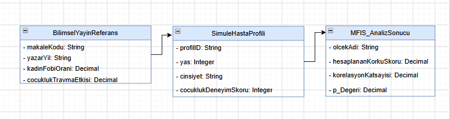

# Tripanofobi (İğne Korkusu) ve Çocukluk Dönemi Deneyimleri İlişkisi Araştırması

Bu proje; bireylerin demografik özellikleri ile çocukluk dönemi öğrenilmiş deneyimlerinin, tripanofobi (iğne korkusu) seviyeleri üzerindeki etkisini ve aralarındaki ilişkiyi incelemek amacıyla yürütülmektedir.

## 📌 Proje Hakkında
* **Genel Çalışma Alanı:** Hastalar ve İğne Korkusu (Tripanofobia)
* **Problem Tanımı:** Bireylerin yaş ve cinsiyet gibi demografik özellikleri ile çocukluk döneminde yaşadıkları olumsuz deneyimlerden (travma, korkutulma) hangisinin tripanofobi seviyesiyle daha güçlü bir ilişkiye sahip olduğunun net olarak bilinmemesi.
* **Araştırma Sorusu:** Bireylerin özellikleri ve çocukluk dönemi öğrenilmiş olumsuz deneyimleri ile tripanofobi (iğne korkusu) seviyeleri arasında anlamlı bir ilişki var mıdır?

## 📊 Veri Seti ve Değişkenler
* **Veri Kaynağı:** Bu araştırmada doğrudan katılımcılardan veri toplanmamış; literatürde geçerliliği kanıtlanmış 5 adet uluslararası bilimsel yayının ikincil verileri ve prevalans oranları temel alınmıştır.
* **Ölçülen Değişkenler:** Öğrenilmiş olumsuz deneyimler, yaş ve cinsiyet.
* **Ölçüm Birimi:** 0-10 Likert Ölçeği skorları (MFIS-TR tabanlı).

## ⚙️ Yöntem ve Analiz
Toplanan ikincil veriler, simülasyon motoru aracılığıyla modellenecek, grafiksel analizler ve korelasyon testleri uygulanarak değerlendirilecektir.

* **H₀ (Sıfır Hipotezi):** Bireylerin öğrenilmiş olumsuz deneyimleri, cinsiyetleri ve yaşları ile tripanofobi seviyeleri arasında anlamlı bir ilişki yoktur.
* **H₁ (Alternatif Hipotez):** Öğrenilmiş olumsuz deneyimler, erkek cinsiyeti ve yaş küçüldükçe iğne korkusu (tripanofobia) artmaktadır.

---

## 📊 UML Diyagramları

### 1. Use Case (Kullanım Durumu) Diyagramı

**Diyagram Açıklaması:**
Bu diyagram, Tripanofobi İkincil Veri Analiz ve Simülasyon Sisteminin fonksiyonel yeteneklerini modellemektedir. Proje, ders yönergesine tam uyumlu şekilde canlı katılımcılardan bağımsız kurgulandığı için sistemde dış aktör bulunmamakta; tüm süreç "Araştırmacı" aktörü tarafından yönetilmektedir. Sistem; literatür parametrelerinin tanımlanması, ikincil veri setinin modellenmesi (sentetik örneklem üretimi ve outlier temizliği dahil), hipotez testlerinin çalıştırılması (p-değeri hesabı) ve sonuçların PDF/PNG formatında dışa aktarılması işlevlerini kapsamaktadır.

### 2. Activity (Etkinlik) Diyagramı

**Diyagram Açıklaması:**
Bu diyagram, projenin temel iş sürecini, ikincil verilerin işlenme adımlarını, karar mekanizmalarını ve ölçülebilir veri akışını yatay bir düzlemde temsil etmektedir. Ders notlarında yer alan geleneksel saha araştırması akış mimarisine sadık kalınarak, proje kısıtları doğrultusunda tamamen özgün bir simülasyon döngüsüne dönüştürülmüştür. Süreç, 5 adet bilimsel yayının istatistiksel girdi değerlerinin sisteme tanımlanmasıyla başlar. Akış üzerinde konumlandırılan karar noktası (baklava dilimi), yüklenen dağılım oranlarının doğruluğunu matematiksel olarak denetler. Doğrulama başarısız olursa akış parametre girişinin revize edilmesine yönlendirilir; doğrulama sağlandığında ise makale prevalans oranlarına tam uyumlu bir "Sentetik Hasta Veri Seti" modellenir. Sonraki fazlarda veri bütünlüğünü korumak adına uç değerler temizlenir; Çok Boyutlu Enjeksiyon Korkusu Ölçeği (MFIS) tabanlı korelasyon analizleri yürütülerek süreç analiz raporunun üretilmesiyle başarılı bir şekilde sonlandırılır.

### 3. Class (Sınıf) Diyagramı

**Diyagram Açıklaması:**
Bu diyagram, projenin ikincil veri analiz süreçlerinde kullanılan temel veri varlıklarını, bu varlıkların sakladığı öznitelikleri (Attribute) ve aralarındaki yapısal ilişkileri kavramsal düzeyde modellemektedir. Ders notlarında belirtilen metodolojik uyarılar dikkate alınarak, diyagram statik veri yapısını netleştirmek adına fonksiyonel metotlar barındırmayacak şekilde tasarlanmıştır. Model; ikincil veri kaynaklarının künyesini ve dağılımlarını tutan `BilimselYayinReferans`, bilgisayar ortamında simüle edilen örneklemi temsil eden `SimuleHastaProfili` ve nihai istatistiksel çıktıları (korelasyon katsayısı, p-değeri vb.) muhafaza eden `MFIS_AnalizSonucu` sınıflarından oluşmaktadır.
